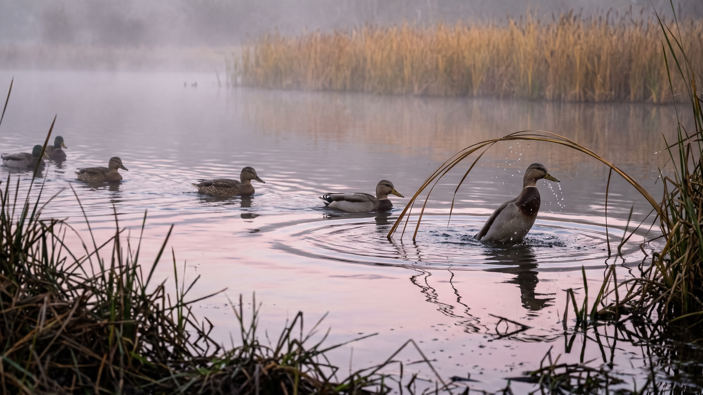
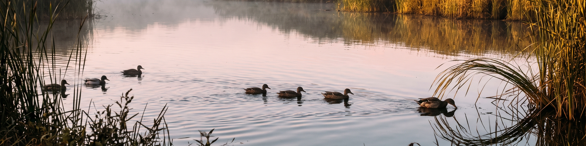
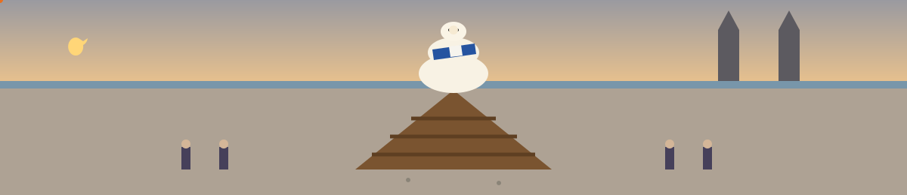

# macOS-Audio-Ducking-Setup

<p align="center"></p>





macOS audio ducking setup blackhole + audio hijack


## What this repo is

This repo is a setup note, not a script. There are no configuration
files or install commands here beyond the two project links below; the
steps are manual settings in the two apps.


## To setup

Set the system-wide audio output to the blackhole 2ch driver and then setup audio hijack with an output device and audio ducking.

I keep the order in that setup on purpose. My system sound has to go into the BlackHole driver first, because that is the sound Audio Hijack then works on. Audio Hijack does the ducking and sends the result to my real output device. If I set Audio Hijack up before the system output points at BlackHole, it has no system sound coming in to duck.

```
https://github.com/ExistentialAudio/BlackHole
https://rogueamoeba.com/audiohijack/
```

The order above is the point of the note: BlackHole first, then Audio
Hijack. The setup was not run live in this pass.
